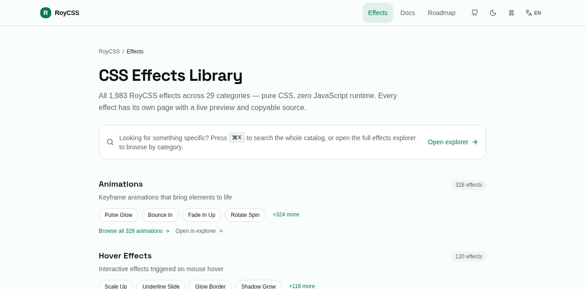

<div align="center">


# RoyCSS

### The AI-native frontend engineering platform

Building the operating system for design-to-code execution, UI systems, and product velocity.

**This README doubles as the company blueprint — thesis, product, moat, model, and roadmap in one place.**

[](https://roycss.vercel.app)
[](#key-metrics)
[](#key-metrics)
[](#product-suite)
[](#key-metrics)
[](#quality-and-governance)
[](LICENSE)

Live demo: <https://roycss.vercel.app>

</div>

---

## The blueprint at a glance

- **What** — an AI-native platform that turns frontend design execution into a governed system: a 1,983-effect CSS catalog, 62 platform products, 70 developer tools, and an AI-assisted workflow layer, wired into one codebase.
- **Who it serves** — product teams, agencies, and the developers who ship interfaces but should not be hand-rolling motion, theming, and accessibility every sprint.
- **Why it wins** — the catalog is *versioned, machine-readable data*. A byte-stable, CI-gated artifact pipeline means AI agents can consume it safely and humans can trust it. That data layer is the moat.
- **How it monetizes** — open core. The library and catalog stay free (distribution engine); platform products, team workflows, and AI services form the commercial layer.
- **Where it is today** — live public console, 2,200+ automated tests, strict TypeScript gate, deterministic manifest pipeline, and a programmatically produced brand/video asset kit.
- **The ask** — early capital to convert a working platform into a distribution machine: npm launch, docs and SEO growth loops, and the paid tier.

---

## The problem

Modern frontend teams lose velocity in four compounding ways:

1. **Fragmented tooling.** Component libraries, animation snippets, design tokens, AI copilots, and QA gates are stitched together by hand.
2. **Repetitive UI work.** The same hover states, reveals, loaders, and themes get rebuilt across every project and platform.
3. **Quality that does not scale.** Accessibility and performance standards depend on individual vigilance instead of system defaults.
4. **AI amplifies the chaos.** Code generation ships interfaces faster than ever — and ships inconsistency just as fast. Models need structured, trustworthy UI data to generate quality output.

---

## The solution

RoyCSS consolidates the frontend execution layer into one platform:

- UI patterns that are searchable, previewable, and copyable — not buried in gist threads
- A production-ready effect catalog with automated quality and accessibility tiering
- AI-native assistance across ideation, architecture, implementation, mentorship, and review
- Platform-level standards so consistency, speed, and UX quality are enforced by default

The result is a compounding advantage: better UX, faster delivery, and a frontend system that gets more valuable with every effect added.

---

## Product suite

| Layer | What it delivers | Scale today |
|---|---|---|
| Effect catalog | Production-ready CSS effects and UI patterns | 1,983 effects across 29 categories |
| Live console + Effects Lab | Interactive, shareable demos — holo foil, liquid glass, glitch, pointer-tracked 3D tilt, glyph decoder, sonar radar | 8 signature live tiles |
| Platform products | Studio tooling, AI surfaces, inspection, cloud, academy, marketplace workflows | 62 products |
| Developer tools | Generation, analysis, conversion, and QA utilities | 70 tools |
| RoyAI layer | LLM-backed modules for architecture, design, mentorship, review, pairing | Modular, in-repo |
| Backend API | Modular services with documented, drift-checked APIs | 289 routes, 75 modules |
| Distribution | npm package, CLI, MCP server, VS Code extension | Artifacts in repo |

---

## Why now

1. **Modern CSS crossed the threshold.** `@property`, `oklch()`, `color-mix()`, `:has()`, container queries, and scroll-driven animations now deliver what previously required JavaScript libraries — with zero runtime cost.
2. **AI code generation went mainstream.** Models are only as good as the structured data they can consume. Catalogs-as-data become the supply chain for AI-driven UI generation.
3. **Polish became a conversion lever.** Product surfaces compete on experience quality. Teams need systemized motion and accessibility defaults, not one-off snippets.

---

## Key metrics

These are not marketing placeholders — the repo includes test assertions and CI gates that keep the numbers aligned with reality.

| Metric | Value | Source |
|---|---:|---|
| CSS effects | 1,983 | `src/lib/roycss-effects.ts` + effect-count tests |
| Effect categories | 29 | live homepage + category tests |
| Platform products | 62 | product registry |
| Backend modules | 75 | backend API modules |
| Backend API routes | 289 | documented in `API.md` |
| Developer tools | 70 | platform tool registry |
| Tests | 2,200+ | frontend + backend automated suites |
| Typecheck | 0 errors | strict TypeScript gate |
| Manifest maturity | 1,277 stable · 664 beta · 42 experimental | generated `dist/roycss.manifest.json` |
| Quality distribution | A 159 · B 1,173 · C 522 · D 109 · F 20 | quality-tier gate |
| Core payload | 12 kB core CSS, zero runtime dependencies | distribution artifacts |

---

## Technology moat

1. **Effects as data.** Every effect is described in a generated, byte-stable manifest (a 275.7 KB JSON artifact) with maturity, quality, accessibility, and browser-tier metadata. If artifacts and catalog ever disagree, CI fails.
2. **Deterministic pipeline.** Regeneration is reproducible byte-for-byte on any machine — verified across repeated runs with zero inter-run churn. Safe for automation; safe for AI consumption.
3. **Governance by default.** 2,200+ tests, strict TypeScript, naming-convention gates, API drift detection, and accessibility tiers with motion-safe defaults.
4. **Distribution-native.** Framework-agnostic output across CSS, Tailwind, SCSS, CSS-in-JS, Vue, and HTML — plus CLI, MCP, and VS Code surfaces that meet developers where they already work.
5. **Compounding catalog.** Every new effect increases the value of search, preview, and AI retrieval across the entire system.

---

## Business model

Open core, four ladders:

| Tier | What is included | Model |
|---|---|---|
| Free forever | Core CSS library, full effect catalog, docs, Effects Lab | MIT — the growth engine |
| Pro | Platform products: studio tooling, inspection, cloud workflows | Per-seat SaaS (planned) |
| Team and enterprise | Shared workspaces, governance controls, SSO, priority support | Annual contracts (planned) |
| AI services | RoyAI generation and review API, integrations | Usage-based (planned) |

The free tier is deliberate: a zero-friction catalog is the cheapest possible distribution in a market where developers choose tools individually and bring them to work.

---

## Go-to-market

Developer-led growth loops:

1. Open-source adoption of the free core
2. Docs and SEO capture high-intent effect queries
3. Shareable Effects Lab demos turn users into promoters
4. GitHub community and stars compound discovery
5. Platform products convert individuals into team accounts

Launch sequence: npm publish, developer-community launches, short-form video (assets already produced — a 51-second narrated product overview and a 10-second brand sting in `marketing/videos/`), and marketplace listings.

---

## Competitive positioning

| Approach | Pattern | The gap RoyCSS fills |
|---|---|---|
| Component libraries | shadcn/ui, MUI | Ship components, not a governed effect system or an AI-consumable data layer |
| Animation libraries | GSAP, Framer Motion, Animate.css | JavaScript runtime cost; no catalog governance or accessibility tiering |
| AI page builders | Prompt-to-site tools | Opaque output, no reuse system, no engineering-grade pipeline |
| In-house design systems | Custom token pipelines | Expensive to build and maintain; RoyCSS ships the defaults prebuilt |

RoyCSS is designed to complement the stack teams already have — it runs alongside Tailwind, shadcn/ui, and any framework — rather than demanding a migration.

---

## Proof of execution

- Live public console with the full catalog, Effects Lab, and docs: <https://roycss.vercel.app>
- Deterministic artifact pipeline verified green end-to-end (manifest and package build reproduced twice with zero inter-run churn)
- Marketing engine produced programmatically: logo suite, banners, product screenshots, narrated overview video — with regeneration scripts committed
- Dual backend strategy in motion (Express + Prisma today, Go-based production target underway) with 289 documented routes
- CI enforcement: tests, strict typecheck, naming gates, artifact drift gates, deploy previews

<div align="center">



<p><sub>The live console — every effect previewable and copyable at <a href="https://roycss.vercel.app">roycss.vercel.app</a></sub></p>

</div>

---

## Roadmap

| Horizon | Focus | Markers |
|---|---|---|
| Now | Distribution unlock | npm publish, docs polish, launch content |
| Next | Monetization surfaces | Pro tier wiring, marketplace, AI service endpoints |
| Later | Platform scale | Go backend cutover, cloud workflows, enterprise governance |

---

## What capital unlocks

| Allocation | Investment |
|---:|---|
| 50% | Engineering — catalog expansion, Pro productization, AI features |
| 25% | Growth — docs and SEO, launch campaigns, developer relations |
| 15% | Infrastructure — cloud, AI inference, telemetry |
| 10% | Partnerships and enterprise pilots |

---

## Risks and mitigations

A blueprint should be honest about risk:

| Risk | Mitigation |
|---|---|
| Adoption | Free core and shareable demos reduce the trial cost to zero |
| Platform and framework shifts | Framework-agnostic output — CSS is the most durable layer of the stack |
| AI commoditization | The moat is governed data and pipeline, not the model itself |
| Solo-founder execution | Modular codebase, documented runbooks, governance docs; capital buys the team |

---

## Quality and governance

RoyCSS is built for teams that need both speed and trust.

- 2,200+ automated tests across frontend and backend systems
- Strict TypeScript validation with zero type errors in the current gate
- WCAG AA-oriented accessibility practices and automated axe audits
- API documentation with drift detection so docs and code stay aligned
- Secure response headers and a static safe CSP for production deployments
- Fail-fast backend validation using environment checks before runtime drift

Product velocity is only durable when quality is enforced by default.

---

## Technical foundation

### Frontend
- Next.js 16 App Router, React 19, TypeScript 5 strict mode
- Tailwind CSS 4 and shadcn/ui patterns
- PWA-ready architecture with service worker support

### Backend
- Express + Prisma + Zod
- Route-level API organization with modular backend services
- SQLite in development, PostgreSQL-ready production path
- Dual backend strategy with an incremental Go migration target

### Distribution
- npm package artifacts for consumer usage
- CLI and MCP tooling for automation and AI assistant workflows
- VS Code extension support for in-editor development

---

## Getting started

### Install the package

```bash
npm install roycss
```

### Run the project locally

```bash
git clone https://github.com/Roy-Wanyoike/Roycss.git
cd Roycss
bun install
bun run dev
```

The frontend runs standalone because the full catalog ships in-repo. For the backend API and the full platform stack, follow the development instructions and backend configuration guide in the docs.

---

## Contribute

We welcome issue reports, bug fixes, UI improvements, and feature proposals.

1. Check existing issues before opening a new one.
2. Fork the repo and create a feature branch.
3. Keep changes focused and validate with the relevant checks.
4. Open a pull request with a clear explanation of the change and its impact.

Full guide: [docs/CONTRIBUTING.md](docs/CONTRIBUTING.md)

## License

MIT. See [`LICENSE`](LICENSE).

## Contact

Built by [Royford Wanyoike Wamaitha](https://github.com/Roy-Wanyoike).

- GitHub: [@Roy-Wanyoike](https://github.com/Roy-Wanyoike)
- Email: [roywanyoike328@gmail.com](mailto:roywanyoike328@gmail.com)
- Issues: [Open an issue](https://github.com/Roy-Wanyoike/Roycss/issues)
